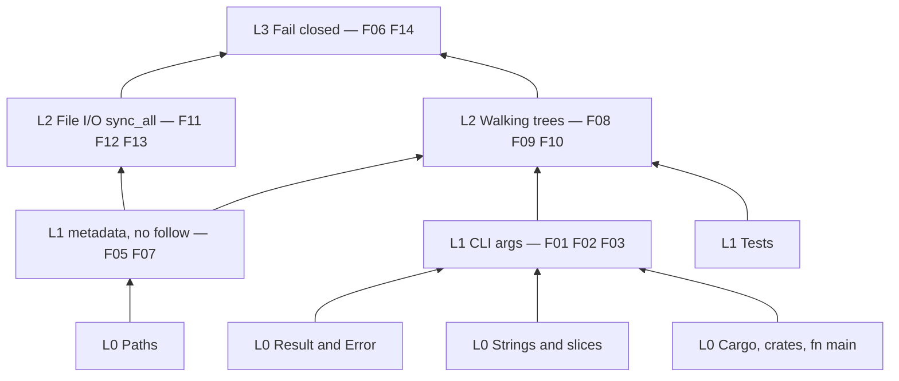

# Skill pyramid

Read modules from the bottom of this tree upward. Each layer uses the one below it. The function numbers are the roadmap ids in [`planning/ROADMAP.md`](planning/ROADMAP.md). 0.0.1 stops at F14.

```text
L6  Concurrency, signals, long jobs, networking      → later: free-space wipe, server cleanup
└─ L5  Handles and ownership, race tests             → later
   └─ L4  Traits and platform cfg                    → later: rename, one filesystem in full
      ├─ L4  Serde and hashing                       → later: JSON plan
      └─ L3  Error discipline, fail closed           → F14 report, F06 banner
         ├─ L2  Walking trees                        → F08 plan, F09 dry run, F10 confirm
         └─ L2  File I/O: OpenOptions, Write, sync   → F11 overwrite, F12 truncate, F13 delete
            ├─ L1  CLI args                          → F01 flags, F02 list split, F03 pattern
            ├─ L1  std::fs metadata, no follow       → F05 classify, F07 protected paths
            └─ L1  Tests
               └─ L0  Cargo, strings, Result, Path
```



0.0.1 teaches L0 through L3. L4 and above are named so you can see what is deliberately left out.
