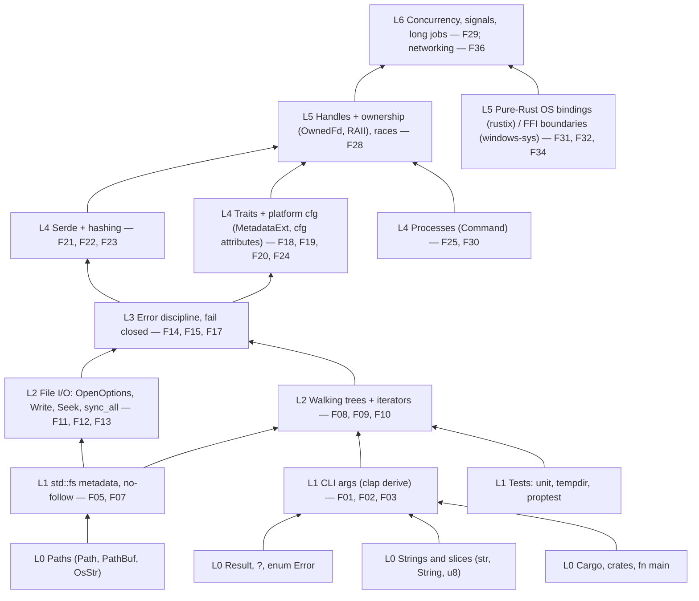

# rmbin — Development roadmap (planning document)

- Revision: 2 · Date: 2026-11-09 (Europe/London, GMT) · Companion to `RMBIN_SCOPE.md` Revision 6
- Status: **planning only. No code written, no repo created, nothing built or released.**
- Legend: **[AGREED]** Stuart's explicit requirement · **[PROPOSED]** suggested, not confirmed · **[OPEN]** unresolved · **[TECHNICAL LIMIT]** a constraint
- Inputs: `RMBIN_SCOPE.md`, private research (SD-01…SD-23 technique IDs; git-ignored, never published).

## 0. Requirements this roadmap serves (Stuart, 2026-11-09)
- [AGREED] Functions ordered by difficulty, low-hanging fruit first.
- [AGREED] **alpha 0.0.1**: a binary that compiles on all systems, with the easiest functions.
- [AGREED] **beta 0.1.1**: more functions.
- [AGREED] Every function is built *and* tested in real situations (real files on real filesystems).
- [AGREED] The code is a tutorial for someone who has only just started learning Rust: clear sections and
  a "skill pyramid" tree of dependencies.
- [AGREED] Pure Rust (see §6 for exactly what that can and can't mean).
- [AGREED] Global public release.
- [OPEN] **Server cleanup placement.** Stuart's message was cut off ("server clean up is ."). Default
  placement: **after beta** (0.2.x or later) until he confirms.
- Unchanged agreed rules: `lol` default pattern + `--pattern`, **no random**, permanent delete is the default,
  `--recycle` never overwrites, `--dry-run`, one confirmation, `--wipe-free-space` opt-in only,
  fail closed (if the overwrite fails, keep the file and report it as NOT securely deleted).

## 1. Release targets
| Release | Goal | Platforms (must compile + pass CI) | Audience |
|---|---|---|---|
| **0.0.1-alpha** | Tiers 0–1: parse, plan, dry-run, overwrite `lol`, sync, truncate, delete, fail closed, honest report | macOS x86_64 + aarch64, Linux x86_64 + aarch64 (musl, static), Windows x86_64 | Testers on **throwaway test volumes only** |
| **0.1.1-beta** | + Tier 2 and the Unix part of Tier 3: rename, link/hard-link/special-file skip, one-filesystem rule, plan/apply/verify with JSON plan + fingerprint, journal, `--recycle`, read-back, APFS snapshot/Time Machine warnings, held directory handles on macOS/Linux | Same 5 targets | Public beta, real projects with backups |
| later (0.2.x+) | `--wipe-free-space`, diagnostics, Windows-specific safety, timestamps, `--tail` [OPEN], server cleanup [OPEN] | + Windows parity | General release (1.0 when Windows parity is done) |

Why the gap 0.0.1 → 0.1.1: Stuart named these two numbers. 0.1.0 is skipped deliberately; patch numbers
0.0.2…0.0.x and 0.1.0-rc.N can be used for fixes in between. [PROPOSED]

## 2. Functions by difficulty (low-hanging fruit first)
Difficulty: 1 = first-week Rust · 5 = expert/OS-internals. "Depends on" uses the F-numbers.
"Real test" = what must pass on a real filesystem, not only in a unit test.

### Tier 0 — difficulty 1 (alpha 0.0.1)
| # | Function | Diff | Why this difficulty | Rust skills taught | Depends on | Real-situation test | Release |
|---|---|---|---|---|---|---|---|
| F01 | CLI skeleton: `--help`, `--version`, flags (`--dry-run`, `--pattern`, `--list`, `--recycle` stub) | 1 | Declarative, no I/O | crates/Cargo, `struct`, derive macros (clap) | — | Run the release binary on each OS, check help text and exit codes | 0.0.1 |
| F02 | Split the `,`/`;` list; positional paths never split | 1 | Pure string logic | `&str` vs `String`, `split`, iterators, `Vec`, unit tests | F01 | Paths with spaces, unicode, `,` in positional names, on APFS/ext4/NTFS | 0.0.1 |
| F03 | Pattern generator: `lol` default, `--pattern 101`, byte at offset `i` = `pattern[i % len]` (SD-01) | 1 | Pure function, easy to test | slices, `%`, `u8`, `Result` for empty pattern, property tests | F01 | Overwrite a file, `xxd` it, confirm only pattern bytes | 0.0.1 |
| F04 | Error type + exit codes (`Error` enum, never panic on user input) | 1 | Small but foundational | `enum`, `Result<T,E>`, `?`, `Display` | — | Missing path, permission denied, read-only USB | 0.0.1 |
| F05 | Path classification without following links (file/dir/symlink/other) | 1 | One std call | `std::path`, `fs::symlink_metadata`, `match` | F02, F04 | Real symlink, alias, junction on each OS: reported, never followed | 0.0.1 |
| F06 | Limits banner in every report (scope §8, assurance level B) | 1 | Static text | `const`, `&'static str`, `println!` | F01 | Visible in every real run | 0.0.1 |

### Tier 1 — difficulty 2 (alpha 0.0.1, except where marked)
| # | Function | Diff | Why | Rust skills | Depends on | Real-situation test | Release |
|---|---|---|---|---|---|---|---|
| F07 | Protected paths: refuse `/`, `$HOME`, system folders, volume roots (own list, SD-19) | 2 | Needs per-OS lists | `cfg!(target_os)`, `HashSet`, `canonicalize` caveats | F05 | Try `/`, `~`, `/System`, `C:\Windows`, `/etc`: all refused | 0.0.1 |
| F08 | Recursive plan listing (read only), sizes, counts, no link following | 2 | Recursion/iterators | `walkdir`, structs, `u64`, iterator chains | F05, F07 | Real project folder with `.git`, `node_modules`, symlinks | 0.0.1 |
| F09 | `--dry-run` report: exactly what would happen, changes nothing | 2 | Reuses plan | `impl Display`, formatting | F08, F06 | Hash every file before/after dry run: identical | 0.0.1 |
| F10 | One confirmation prompt listing targets | 2 | stdin handling | `io::stdin`, `BufRead`, `trim` | F08 | Type `n`, Ctrl-C, empty input: nothing changes | 0.0.1 |
| F11 | In-place overwrite, exact original length, no truncate-on-open, then `sync_all` (SD-01, SD-23) | 2 | Core I/O, buffer loop | `OpenOptions`, `Write`, `Seek`, buffers, `sync_all` (F_FULLFSYNC on Apple via std) | F03, F04 | Raw-image check (§5.2): pattern visible, file length unchanged | 0.0.1 |
| F12 | Truncate to 0 + `sync_all` after overwrite (SD-13) | 2 | One call, order matters | `File::set_len` | F11 | Order verified in journal/log | 0.0.1 |
| F13 | Delete files, then folders bottom-up once empty | 2 | Ordering | `fs::remove_file`, `remove_dir`, reverse iteration | F08, F12 | Deep tree on APFS/ext4/NTFS/FAT32 | 0.0.1 |
| F14 | Fail closed + per-file outcome report ("NOT securely deleted") (SD-10) | 2 | Discipline, not code size | `enum Outcome`, early return, no `unwrap` | F04, F11–F13 | Read-only file, locked file (Windows), full disk, pulled USB | 0.0.1 |
| F15 | Optional read-back `--verify` of visible bytes (cache caveat stated) | 2 | Read loop + compare | `Read`, iterators, `zip` | F03, F11 | Real file, compare; report says "visible bytes only" | 0.1.1 |
| F16 | `--recycle`: move to system bin, never overwrite, no fallback to permanent (scope §4.2) | 2 | Library call, but per-OS behaviour | external crate API, error mapping | F05, F07, F10 | Finder Trash "Put Back" on macOS 13; freedesktop Trash on Linux; Recycle Bin on Windows | 0.1.1 |
| F17 | Redacted logging (no env vars, contents or secrets) | 2 | Config + discipline | `tracing` macros, fields, levels | F04 | grep logs for test secret strings: none | 0.1.1 |

### Tier 2 — difficulty 3 (beta 0.1.1 unless marked)
| # | Function | Diff | Why | Rust skills | Depends on | Real-situation test | Release |
|---|---|---|---|---|---|---|---|
| F18 | One rename to a same-length name built from the pattern before delete (SD-02); avoids Windows reserved names | 3 | Collisions, length limits, per-OS names | `OsString`, char/byte lengths, `cfg` | F03, F13 | Raw-image/dir-listing check: original name not in new name | 0.1.1 |
| F19 | Skip + report hard links (nlink>1), devices, sockets, FIFOs (SD-07) | 3 | Per-OS metadata | traits `MetadataExt`, `#[cfg(unix)]` / `#[cfg(windows)]` | F05, F08 | Real `ln`, `mkfifo`, `mklink /H` | 0.1.1 (Windows nlink: later, see §6) |
| F20 | Stay on one filesystem: skip children on another device (SD-20) | 3 | Device IDs per OS | `MetadataExt::dev()`, comparing IDs | F08 | Mounted USB/disk image inside the target tree: skipped | 0.1.1 (Windows: later) |
| F21 | Plan file (JSON, no contents/secrets) + blake3 fingerprint; `plan`/`apply`/`verify` subcommands | 3 | Serialisation + subcommands | `serde` derive, `serde_json`, clap subcommands, hashing | F08, F14 | Edit the plan by hand → apply refuses | 0.1.1 |
| F22 | Journal + interrupted-run report/resume (SD-21) | 3 | Crash consistency | append-only files, `BufWriter`, flush/sync | F21 | Kill -9 / pull power mid-run on a test volume; next run reports exactly | 0.1.1 |
| F23 | `verify`: targets gone + list what may remain | 3 | Re-scan + compare | `HashMap`, set difference | F21 | Real run then verify on each FS | 0.1.1 |
| F24 | Compressed/sparse/encrypted detection → skip + report (SD-06) | 3 | OS flags differ | `std::os::macos::fs::MetadataExt::st_flags`, block math | F19 | `ditto --hfsCompression`, `truncate -s` sparse, NTFS compressed | 0.1.1 (macOS/Linux); Windows later |
| F25 | APFS snapshot + Time Machine warning, report-only (SD-09) | 3 | Calls system tools read-only | `std::process::Command`, parsing output | F09 | Mac with local snapshots: warning shown; policy [OPEN] (scope §4.3) | 0.1.1 |
| F26 | Optional fixed-epoch timestamp reset (SD-14) | 3 | Per-OS time APIs | `File::set_times` (std), `SystemTime` | F11 | Check times via `stat` before delete | later |
| F27 | Locked/in-use files: report only, never force-close (SD-15) | 3 | Windows sharing errors | error kinds, `raw_os_error` | F14 | Open in Word/Notepad on Windows, run | later |

### Tier 3 — difficulty 4
| # | Function | Diff | Why | Rust skills | Depends on | Real-situation test | Release |
|---|---|---|---|---|---|---|---|
| F28 | Held directory handles: `openat`/`renameat`/`unlinkat` with no-follow + identity re-check (dev, inode, size, nlink) | 4 | Race conditions (path swap) | ownership of handles (`OwnedFd`), RAII, rustix, adversarial tests | F19, F21 | Race test: swap a dir for a symlink mid-run; must refuse | 0.1.1 macOS/Linux; Windows later |
| F29 | `--wipe-free-space` (opt-in): pattern-filled fill files, reserve, ENOSPC back-off, FAT 4 GiB cap, cancel/orphan cleanup (SD-08, SD-21) | 4 | Long-running, disk-full handling, signals | signal handling, `Drop` cleanup, progress, threads | F03, F11, F22 | Fill a real USB (FAT32/exFAT) and a test APFS volume; cancel; restart | later (0.2.x) |
| F30 | SSD/TRIM/FileVault diagnostics, read-only (SD-11) | 4 | OS-specific probes | `Command`, `/sys/block/*/queue/rotational` parsing | F25 | HDD vs SSD vs USB stick labelled correctly | later |
| F31 | macOS xattr/resource-fork reporting | 4 | Unix-only APIs | rustix xattr, `cfg(target_os="macos")` | F28 | `xattr -w` test file reported | later |
| F32 | Windows: no-follow open (`FILE_FLAG_OPEN_REPARSE_POINT` via std `OpenOptionsExt::custom_flags`), nlink + volume ID via file info | 4 | Windows API, unstable std bits | `#[cfg(windows)]`, `windows-sys` (unsafe FFI) | F19, F20 | Junctions, symlinks, hard links on NTFS | later |
| F33 | `--tail` cluster-slack overwrite [OPEN] (SD-05) | 4 | Filesystem cluster sizes | `statvfs`, file extend/restore | F11 | Raw image shows tail overwritten | later [OPEN] |

### Tier 4 — difficulty 5
| # | Function | Diff | Why | Rust skills | Depends on | Real-situation test | Release |
|---|---|---|---|---|---|---|---|
| F34 | Windows NTFS alternate data streams wipe (SD-03) | 5 | Win32 stream enumeration, unsafe FFI | `windows-sys`, `unsafe` blocks, wide strings | F32 | `echo x > file:hidden`; stream gone after run | later |
| F35 | Windows MFT-resident / cluster-chase measurement (SD-04, SD-12) | 5 | Admin, volume handles, high risk | lab harness only | F34 | Expendable NTFS image only | lab only |
| F36 | **Server cleanup [OPEN placement]**: same plan/apply/verify on a server, per-host approval; cloud (DigitalOcean) resources need separate opt-in, exact IDs, own confirmation (scope §11) | 5 | Networking, credentials, remote safety | async or SSH strategy, secrets handling (`zeroize`) | F21–F23, F28 | Disposable Droplet + snapshot; verify backups/snapshots reported, not touched | **after beta by default** |

Rejected (never on roadmap): decoy overwrite SD-16, encrypt-then-overwrite SD-17, multi-pass "standards" SD-18.
Out of scope: Linux swap wipe SD-22 (mentioned in the server checklist only). `unbin` is a separate project.

## 3. Skill pyramid (which Rust skills/modules build on which)
Base at the bottom. A learner reads modules in pyramid order; each module teaches one concept.



Indented tree (same pyramid, top = hardest):
```
L6  Concurrency, signals, long jobs, networking      → F29 wipe-free-space, F36 server [OPEN]
└─ L5  Handles & ownership (OwnedFd, RAII), race tests → F28 held dir handles
   ├─ L5  OS bindings: rustix (Unix), windows-sys (FFI) → F31, F32, F34, F35
   └─ L4  Traits + platform cfg                         → F18 rename, F19 link skip, F20 one-FS, F24 compressed/sparse
      ├─ L4  Serde + hashing                            → F21 plan, F22 journal, F23 verify
      ├─ L4  Processes (std::process::Command)          → F25 snapshots, F30 SSD diagnostics
      └─ L3  Error discipline, fail closed              → F14 outcomes, F15 read-back, F17 logging
         ├─ L2  Walking trees + iterators               → F08 plan list, F09 dry-run, F10 confirm
         └─ L2  File I/O: OpenOptions/Write/Seek/sync   → F11 overwrite, F12 truncate, F13 delete
            ├─ L1  CLI args (clap derive)               → F01 CLI, F02 list split, F03 pattern
            ├─ L1  std::fs metadata, no-follow          → F05 classify, F07 protected paths
            └─ L1  Tests (unit, tempdir, proptest)
               └─ L0  Cargo · strings/slices · Result/? · Path/PathBuf
```

## 4. Tutorial-style crate layout [PROPOSED]
Rust module names can't start with a digit (`mod 01_paths;` is invalid). So files get plain names, and
numbered **section headers** + `docs/TUTORIAL.md` give the reading order. (Alternative: `#[path = "01_paths.rs"] mod paths;`
— rejected as confusing for beginners.)

```
rmbin/
├─ Cargo.toml            # edition 2021, rust-version pinned (MSRV), every dependency commented
├─ README.md             # install, safety limits, quick start
├─ docs/
│  ├─ TUTORIAL.md        # "read the code in this order", one chapter per module, links to F-numbers
│  ├─ SKILL_PYRAMID.md   # §3 of this file
│  ├─ COMPARISON.md      # competitor comparison, under the docs policy (§9)
│  └─ TESTING.md         # §5 real-device checklist
├─ src/
│  ├─ main.rs            # Section 00: entry point; only wires modules together
│  ├─ error.rs           # Section 01: Result, ? and our Error enum          (L0)
│  ├─ cli.rs             # Section 02: command-line flags with clap           (L1) F01
│  ├─ input.rs           # Section 03: splitting the , ; list                 (L1) F02
│  ├─ pattern.rs         # Section 04: the `lol` pattern, no random           (L1) F03
│  ├─ classify.rs        # Section 05: what is this path? no-follow metadata  (L1) F05
│  ├─ protect.rs         # Section 06: protected paths                        (L1) F07
│  ├─ plan.rs            # Section 07: listing the tree, read only            (L2) F08, F09
│  ├─ confirm.rs         # Section 08: one confirmation                       (L2) F10
│  ├─ overwrite.rs       # Section 09: overwrite, sync_all, truncate          (L2) F11, F12, F15
│  ├─ remove.rs          # Section 10: rename, delete, folders bottom-up      (L2/L4) F13, F18
│  ├─ report.rs          # Section 11: outcomes, fail closed, limits banner   (L3) F06, F14
│  ├─ recycle.rs         # Section 12: --recycle (never overwrites)           (L2) F16
│  ├─ platform/          # Section 13: one concept per OS
│  │  ├─ mod.rs          #   trait FileIdentity { dev, inode, nlink }         (L4)
│  │  ├─ unix.rs         #   #[cfg(unix)]   F19, F20, F28 (rustix)
│  │  ├─ macos.rs        #   #[cfg(target_os="macos")] F24, F25, F31
│  │  └─ windows.rs      #   #[cfg(windows)] F32, F34 (later)
│  ├─ planfile.rs        # Section 14: JSON plan + fingerprint                (L4) F21
│  ├─ journal.rs         # Section 15: journal, resume                        (L4) F22, F23
│  └─ freespace.rs       # Section 16: --wipe-free-space (later)              (L6) F29
└─ tests/                # integration tests on real temp dirs, one file per section
```
Tutorial rules [AGREED in spirit, details PROPOSED]:
- Every file opens with a header block: section number, "What you'll learn", "Builds on" (pyramid level),
  "Used by", and the F-numbers it implements.
- One concept per module. Comments explain *why*, not just *what*; beginner terms explained at first use.
- No `unwrap()`/`expect()` outside tests; no `unsafe` in rmbin's own code (`#![forbid(unsafe_code)]`).
  Windows FFI (F32/F34) would need an exception and a separately reviewed module.
- Each section has a matching test file and a "try it yourself" exercise in `docs/TUTORIAL.md`.
- `cargo doc` output doubles as the tutorial index.

## 5. Testing in real situations
### 5.1 CI matrix [PROPOSED] (GitHub-hosted runners, labels checked 2026-11-09)
| Target | Runner | Build | Unit + integration tests | Notes |
|---|---|---|---|---|
| `x86_64-apple-darwin` | `macos-15-intel` | yes | yes (APFS) | GitHub says this is the last Intel image, available until Aug 2027. **No macOS 13 runner exists** → macOS 13 is manual (§5.2) |
| `aarch64-apple-darwin` | `macos-15` | yes | yes (APFS) | |
| `x86_64-unknown-linux-musl` | `ubuntu-24.04` | yes (static) | yes (ext4), + loop-mounted FAT32/exFAT image | |
| `aarch64-unknown-linux-musl` | `ubuntu-24.04-arm` | yes (static) | yes (ext4) | native, no emulation |
| `x86_64-pc-windows-msvc` | `windows-2025` | yes | yes (NTFS) | from 0.0.1 it must compile and pass; Windows-specific safety F32 is later |
Every job also runs `cargo fmt --check`, `cargo clippy -D warnings`, `cargo deny` (licences + advisories),
a "no C" check (§6.3) and the MSRV build.

### 5.2 Real-device checklist (manual, per release) [PROPOSED]
Use **test data only** (fake tokens like `FAKE_DO_TOKEN_123`). Never test on real secrets first.
- [ ] **Stuart's 2014 Intel Mac, macOS 13.0, APFS internal SSD**: dry run, real run, Finder Trash restore (`--recycle`), local snapshot warning (`tmutil localsnapshot` first).
- [ ] macOS: APFS **disk image** (`hdiutil create -fs APFS`) → run → detach → search the raw `.dmg` for the fake token and for `lol`. Expect: token may still be present due to copy-on-write → report must say so honestly.
- [ ] macOS: HFS+ disk image, same search (overwrite should land in place).
- [ ] Linux x86_64 server (e.g. a disposable Droplet) and arm64 box: ext4 loop image, `grep -a` the raw image for the token.
- [ ] Windows 10/11 x86_64: NTFS VHD (`diskpart`), same raw search; junction + symlink + hard link refusal.
- [ ] USB stick formatted **FAT32** and **exFAT** on each OS: delete, raw search, 4 GiB cap (later, F29).
- [ ] Edge cases on each FS: unicode/emoji names, spaces, `,`/`;` in names, 0-byte file, >4 GiB file, read-only file, full disk, USB pulled mid-run, Ctrl-C mid-run.
- [ ] Protected paths: `/`, `~`, `/System`, `/etc`, `C:\Windows`, a mount point → refused.
- [ ] Logs and plan files contain none of the fake secrets.
- [ ] Record results (OS build, FS, rmbin version, pass/fail) in `docs/TESTING.md`.

## 6. Pure Rust: what it means and what was found
### 6.1 Definition [AGREED requirement, wording PROPOSED]
"Pure Rust" = **no third-party C/C++ code compiled or linked, no build scripts that compile C, no `-sys`
crates that wrap C libraries**. [TECHNICAL LIMIT] It cannot mean "no OS calls in C": on macOS every
syscall goes through Apple's libSystem, and on Windows through kernel32/ntdll — Rust's own `std` does this.
On Linux musl, Rust links its bundled musl C library statically into the binary (it ships with the Rust
toolchain). Windows MSVC builds link the MSVC runtime. These are the platform's C runtime, not third-party code.

### 6.2 Crate check (run 2026-11-09 with `cargo tree` for all 5 targets, rustc 1.85.1; versions resolved, not yet pinned)
| Crate | Pure Rust? | Finding |
|---|---|---|
| std | yes | Uses the OS libc/kernel32 as above. `sync_all` = F_FULLFSYNC on Apple (SD-23) |
| clap 4 (derive) | yes | No C |
| serde / serde_json | yes | No C |
| blake3 1.8.7 + `features = ["pure"]` | yes, **only with `pure`** | `cc` is still a *build-dependency*, but a test build with `pure` compiled **zero** C/asm objects (Linux x86_64). Without `pure` it compiles C/asm SIMD. Alternative: `sha2` (RustCrypto) |
| tracing / tracing-subscriber | yes | No C |
| walkdir 2 | yes | Uses `winapi-util`/`windows-sys` on Windows (Rust bindings, no C code) |
| rustix 1.1.6 (`fs`) | **Linux: yes** (linux_raw backend via `linux-raw-sys`, no libc) · **macOS: uses `libc` crate** (Rust bindings to libSystem; no C compiled) · **Windows: no `fs` module at all** | ⚠ Flag: on Windows rmbin needs std + `windows-sys` instead |
| trash 5.2.9 | **⚠ concern** | macOS: `objc2` + `objc2-foundation` (Rust bindings calling the Objective-C runtime; default method runs `osascript` → Finder). Linux: `libc` crate. Windows: `windows` 0.62 (COM). No C compiled, but heavy `unsafe` FFI and the biggest dependency. Options: keep (it's bindings, not C), or write a small own macOS Finder path via `Command("osascript")` [OPEN] |
| tempfile / proptest (dev only) | yes | Not shipped in the binary |
| cargo-deb (tool) | yes | Build tool, not linked |
| windows-sys (later) | bindings only | Pure Rust declarations, but calls are `unsafe` FFI |
Also found: newest `trash` 5.3.0 and `proptest` 1.12.0 need Rust ≥1.87/1.88 → **pin an MSRV** when the project starts.
Unstable std on Windows: `MetadataExt::number_of_links` and `volume_serial_number` are not stable → F19/F20
on Windows need `windows-sys` (`GetFileInformationByHandle`) → scheduled "later".

### 6.3 Enforcement in CI [PROPOSED]
- `cargo tree -e normal,build --target <each>` must not contain `cc`-compiled crates except blake3 with `pure`;
  fail if any `*.o`/`*.a` appears under `target/*/build/`.
- `cargo deny` bans `openssl-sys`, `cmake`, `bindgen`, and any new `-sys` crate unless reviewed.
- `#![forbid(unsafe_code)]` in rmbin's own crate.

## 7. Release checklists
### 7.1 alpha 0.0.1
- [ ] F01–F14 implemented, each with a section header, tutorial chapter and tests
- [ ] Builds for all 5 targets in CI; all tests green; MSRV pinned; `Cargo.lock` committed
- [ ] "No C" check passes on all targets
- [ ] Real-device checklist §5.2 done for APFS (Stuart's Mac), ext4, NTFS, FAT32 USB — results in `docs/TESTING.md`
- [ ] README states: alpha, test volumes only, limits banner (§8 of scope), no warranty
- [ ] Licence chosen [OPEN] (MIT/Apache-2.0 dual is common for Rust). Reviewed sources were read for ideas only; **no code copied** — keep it that way
- [ ] Name checks: `rmbin` and `unbin` were **free on crates.io on 2026-11-09** (API 404); also check GitHub org, Homebrew, Debian/Ubuntu package names, trademarks
- [ ] GitHub Release `v0.0.1-alpha`: 5 archives (`.tar.gz` macOS/Linux, `.zip` Windows), `SHA256SUMS`, signature (see 7.3), changelog
- [ ] Not yet on Homebrew core/apt stable; optional `--HEAD`/pre-release tap formula
### 7.2 beta 0.1.1
- [ ] All 0.0.1 items + F15–F25, F28 (Unix) implemented, documented, tested
- [ ] Adversarial race tests for F28; kill/power-cut test for F22
- [ ] Snapshot policy decided (scope §4.3 [OPEN])
- [ ] crates.io publish (`cargo publish`), same version everywhere
- [ ] Homebrew formula in the tap (build from source, `cargo install --locked`, like qrbin)
- [ ] Signed apt repo (amd64/arm64) via `cargo-deb`, `signed-by` keyring, pin file
- [ ] `docs/COMPARISON.md` checked under §9 policy (anonymised, behaviour only, claims re-checked)
- [ ] Security policy (`SECURITY.md`), contact for corrections, issue templates
### 7.3 Global release mechanics [PROPOSED]
- GitHub Releases with `SHA256SUMS` + signatures (options: minisign/rsign2 key, or Sigstore/GitHub artifact attestations) [OPEN]
- macOS: unsigned binaries trigger Gatekeeper on browser downloads; Developer ID signing + notarisation needs an Apple Developer account [OPEN]. Homebrew from-source builds avoid this.
- Windows: Authenticode signing optional [OPEN]; SmartScreen warnings without it.
- Reproducible-ish builds: pinned toolchain, `--locked`, recorded in release notes.
- No self-update, no telemetry; install/uninstall never deletes user data (scope §10).

## 8. Server cleanup [OPEN placement]
Stuart's message was cut off ("server clean up is ."). Until confirmed: **after beta 0.1.1**. The Linux musl
binary from 0.0.1 can already run *on* a server by hand; F36 (remote orchestration, cloud resources) waits.
Swap (SD-22), backups, snapshots, tokens and DNS stay checklist items (scope §11), not automatic actions.

## 9. Competitor comparison docs policy [AGREED 2026-11-09, revised r2]
Public docs may say what other tools don't do and what rmbin does, without naming anyone:
1. [AGREED] **Anonymised references only**: "Example app 1" … "Example app 6", one number per reviewed source.
   No names, repo URLs, commit hashes, file paths, line numbers, distinctive file/function names, licences,
   languages or other identifying detail anywhere public.
2. [AGREED] The identity key lives only in `private/EXAMPLE_APPS_KEY.md`; `private/` and `research/` are
   git-ignored (`.gitignore`) and never published.
3. Describe behaviour generically, not intent. Never use "backdoor", "lies", "fake", "insecure", "scam" or similar.
4. Prefer a behaviour table framed as "what rmbin does" (forces data to disk before delete, keeps the file if
   the overwrite fails, one honest pass, warns on APFS snapshots).
5. Date claims "as reviewed in Nov 2026" and note the apps may have changed since.
6. No superiority claims beyond tested behaviour; rmbin's own limits are stated in the same document.
7. Offer a correction/contact route; corrections are made promptly. Trademarks belong to their owners.
8. [AGREED] No legal-review step (removed at Stuart's request).
Draft: `docs/COMPARISON.md`.

## Change log
- r1 2026-11-09: first roadmap (tiers F01–F36, skill pyramid, layout, CI matrix, real-device and release
  checklists, pure-Rust crate check, competitor docs policy).
- r2 2026-11-09: §9 policy anonymised (Example app 1–6, private key), legal-review step removed, names scrubbed.
